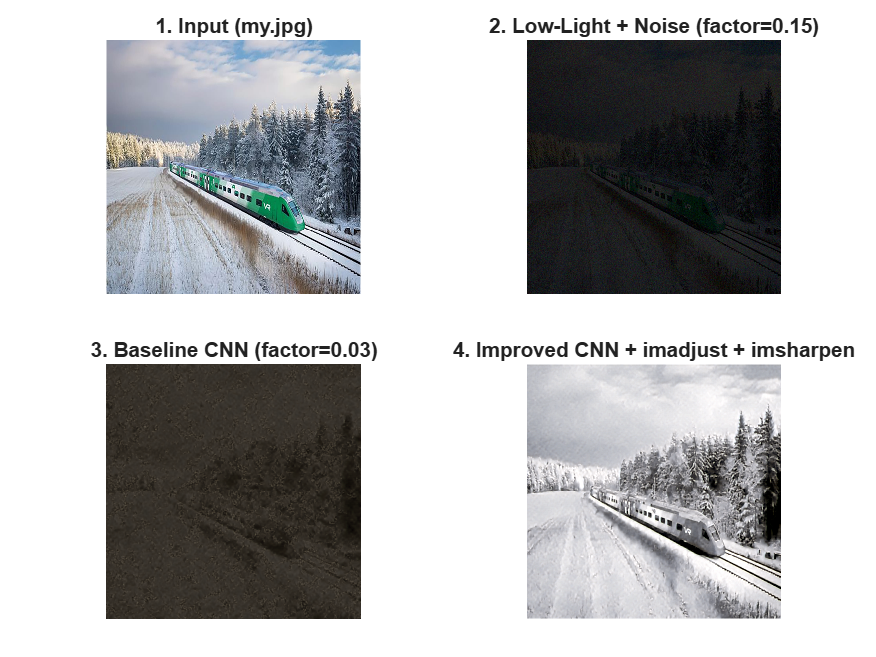
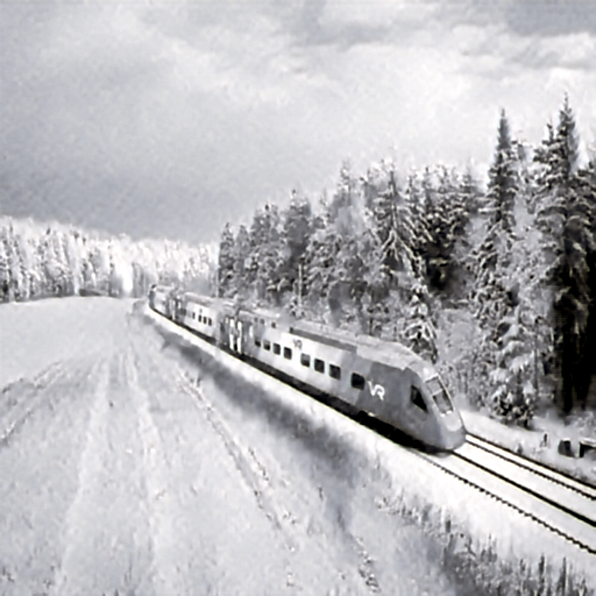

# Low-Light Image Enhancement Using Pretrained "Learning to See in the Dark" CNN

## Overview
MATLAB implementation of a low-light image enhancement pipeline using MathWorks' pre-trained **Learning to See in the Dark (`trainedLowLightCameraPipelineNet`)** deep learning model in MATLAB (`R2026b Update 2`).

## Repository Contents
* `low_light_enhancement.m` — Complete MATLAB script that downloads the pre-trained model, simulates low-light sensor noise, runs CNN inference, applies post-processing enhancements, and exports result images.
* `Example_03.png` *(or `my.jpg`)* — Input image used for testing.
* `enhanced_result.png` — Final enhanced RGB output image.
* `comparison_result.png` — Side-by-side comparison of the input, simulated low-light noisy image, baseline CNN output, and improved pipeline output.

---

## Pipeline Stages
1. **Model Setup:** Downloads and loads `trainedLowLightCameraPipelineNet.mat` (`netTrained`).
2. **Input Preparation:** Loads `Example_03.png` (or `my.jpg`), ensures 3-channel RGB format, and resizes to `512 × 512` (`single`).
3. **Low-Light & Noise Simulation:** Scales brightness by `darkFactor` and adds zero-mean Gaussian sensor noise (`imnoise`).
4. **4-Channel Input Construction & Inference:** Converts the dark noisy frame to grayscale, replicates it across 4 pseudo-RAW channels (`H × W × 4`), wraps it in a `"SSCB"` `dlarray`, and runs `predict(netTrained, input)`.
5. **Post-Processing Enhancement:** Applies percentile contrast stretching (`imadjust` + `stretchlim`) and unsharp masking (`imsharpen`).

---

## Improvements Made to the Process
Compared to the baseline starter script, two targeted improvements were introduced:
1. **Adjusted `darkFactor` (`0.03` → `0.15`) and Noise Variance (`0.002` → `0.0005`):** Because `Example_03.png` / `my.jpg` is already a dark image (unlike bright `peppers.png`), `darkFactor = 0.03` suppressed shadow values below the noise floor. Increasing `darkFactor` to `0.15` preserved faint structural details for the CNN to recover.
2. **Added `imadjust` and `imsharpen` Post-Processing:** Replicating grayscale into 4 pseudo-RAW channels causes the network output to appear slightly hazy and soft. Applying `imadjust(out, stretchlim(out, [0.01 0.99]), [])` followed by `imsharpen(..., "Radius", 1.2, "Amount", 0.6)` improved global contrast and restored crisp edge definition.

---

## Results

### Pipeline Comparison

### Final Enhanced Output

## How to Run
1. Clone or download this repository and open MATLAB (`R2026b Update 2` with the **Deep Learning Toolbox** and **Image Processing Toolbox**).
2. Place `Example_03.png` (or `my.jpg`) in the same folder as `low_light_enhancement.m` and click **Run**.

## Use of AI Tools
AI assistance (Gemini) was used to add multi-channel input safeguards, implement the `darkFactor` and `imadjust`/`imsharpen` improvements, and format `README.md`. All code was executed in MATLAB and all outputs were verified by the author.
