# Studded Tire Checkpoint — Automated Roadside Tire Classification

**Course:** DSP – Image Processing Final Project  
**Reproducibility:** Fixed random seed (`SEED = 42`), read-only original images (`data/original/`), validation-only hyperparameter tuning, and single-pass test evaluation.

---

## Repository Structure

```text
studded-tire-checkpoint/
├── README.md
├── studded_tire_student_starter.ipynb
├── figures/
│   ├── part0_sample_grid.png
│   ├── part1_toolbox.png
│   ├── part1_blob_boxplot.png
│   ├── part1_detector_cases.png
│   ├── part2_cm_classical.png
│   ├── part3_cm_yolo.png
│   ├── part3_confident_errors.png
│   ├── part4_degradations.png
│   ├── part5_wiener_mismatch.png
│   ├── part6_accuracy_vs_blur.png
│   └── part7_pr_curve.png
└── data/
    ├── original/
    ├── blur/
    ├── lowlight/
    ├── combined/
    ├── restored/
    └── results.csv
```

---

## 1. Project Objective
Municipalities restrict or charge for studded winter tires in urban zones to reduce asphalt wear and particulate road dust. This project benchmarks three computer-vision architectures for classifying passing vehicle tires as **studded (`st`)** or **non-studded (`nst`)** across clean and degraded roadside imaging conditions:
1. **Classical Computer Vision Pipeline:** `CLAHE → morphological white top-hat → connected components + HOG → RBF-SVM`
2. **Pretrained Deep Learning Baseline:** Frozen `YOLO11n-cls` (`best.pt`)
3. **Hybrid Preprocessing + Deep Learning:** Classical contrast enhancement (`CLAHE`) and frequency-domain/denoising restoration (`Wiener deconvolution` / `inverse-gamma + NLM + CLAHE`) paired with `YOLO11n-cls`

---

## 2. Dataset Audit & Methodology

### Part 0 — Dataset & Near-Duplicate Leakage Audit
* **Dataset:** 500 tire images (`250` studded `st`, `250` non-studded `nst`) partitioned into `train`, `val`, and `test` splits (`74` test images: `37` `nst`, `37` `st`), resized so the longest edge is ≤ 512 px while keeping `data/original/` untouched.
* **Key Task Challenges:**
  1. **Small Target Scale:** Tungsten-carbide stud heads occupy only a tiny fraction of total image pixels and frequently sit recessed inside deep tread grooves.
  2. **Visual Confounders:** Specular reflections on wet rubber, embedded road gravel, ice crystals, and bright wheel-rim edges mimic small metallic stud pins.
  3. **Viewpoint & Illumination Variance:** Steep camera angles, wheel rotation, and harsh shadows alter both stud visibility and tread texture.
* **Cross-Split `dHash` Leakage Check:** Perceptual difference hashing (`256-bit dHash`, Hamming distance ≤ 10) identifies near-duplicate pairs across splits. Shared near-duplicates between `train` and `test` inflate accuracy estimates via memorization; in production, duplicate clusters should be grouped prior to splitting (`StratifiedGroupKFold`), whereas here the official split is retained for consistent benchmarking.

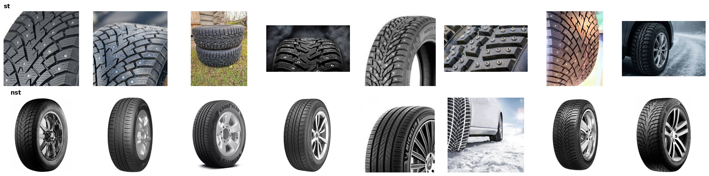

### Part 1 & Part 2 — Classical Toolbox, Stud Detector & SVM Baseline
* **Classical Image Processing Toolbox:** Applies grayscale conversion, CLAHE (`clip=2.0, tile=8×8`), `5×5` Gaussian smoothing, Otsu thresholding, Canny edge detection, and `5×5` elliptical morphological opening and closing.
* **Hand-Made Stud Candidate Detector (`stud_candidates`):** Enhances local contrast via CLAHE, isolates small bright peaks with a morphological white top-hat filter (`cv2.MORPH_TOPHAT`), thresholds at `max(Otsu, min_thr)`, and filters connected components by area (`min_area` to `max_area`) tuned strictly on `val`.
* **Classical Feature Vector & SVM (`classical_features` → `StandardScaler` + `SVC(kernel="rbf")`):** Concatenates the `4` blob statistics (`count`, `mean_area`, `std_area`, `area_fraction`) with a `1,764`-dimensional HOG descriptor (`128×128`, `9` orientations, `16×16` pixel cells, `2×2` cell blocks) into a **`1,768`-element vector**. Tuning `C` in `{0.1, 1, 10, 100}` on `val` yielded `0.6316` (`C=0.1`), `0.6711` (`C=1`), `0.7105` (`C=10`), and `0.7105` (`C=100`), selecting **`C = 10`** (`71.1%` validation accuracy), which achieved **`70.3%` test accuracy** (`0.714` precision, `0.676` recall, `0.694` F1-score on `st`).

| Classical Toolbox | Validation Blob Counts | Detector Successes vs. Failures |
| :---: | :---: | :---: |
| 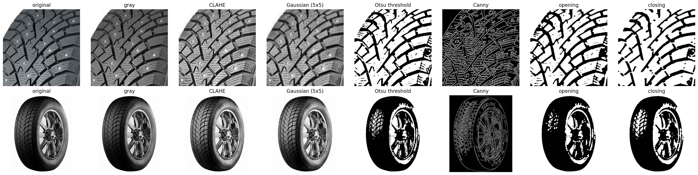 | 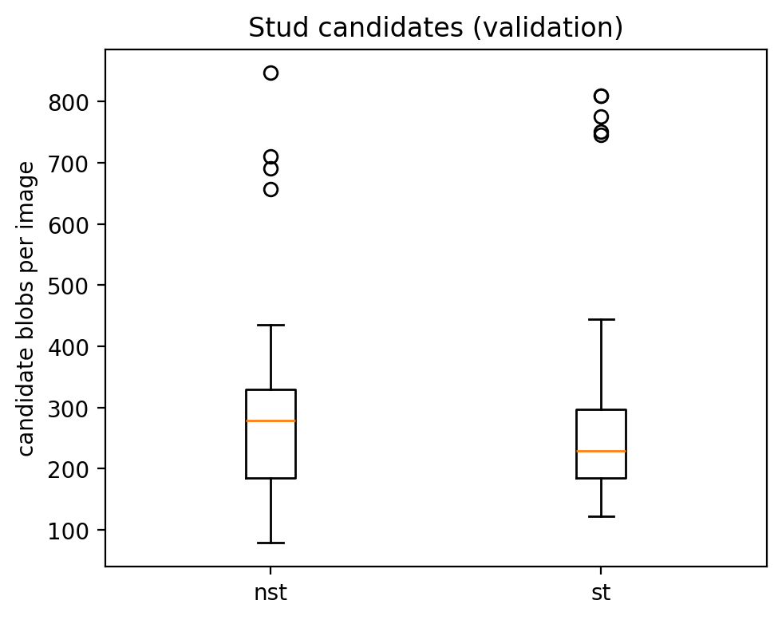 | 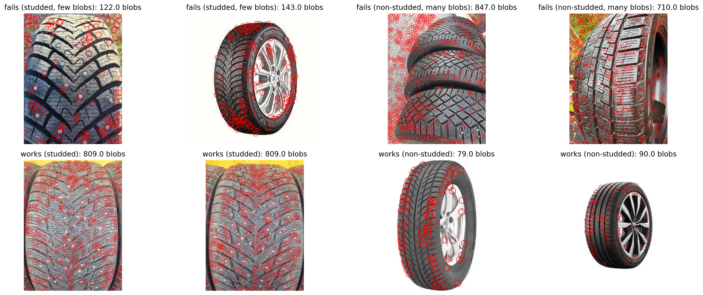 |

### Part 3 — Pretrained Deep-Learning Baseline (`YOLO11n-cls`)
* Evaluated the frozen `YOLO11n-cls` model on clean test images (`n = 74`), achieving **`90.5%` accuracy** (`0.841` precision, `1.000` recall, and `0.914` F1-score on `st`; `1.000` precision, `0.811` recall, and `0.896` F1-score on `nst`).
* Inspected the 6 most confident misclassifications (primarily oblique sidewall crops, snow/shadow-occluded treads, and wet Nordic friction-tire sipes with specular highlights), and measured single-image CPU inference latency.

| Classical Confusion Matrix | YOLO11n-cls Confusion Matrix | Top Confident YOLO Errors |
| :---: | :---: | :---: |
| 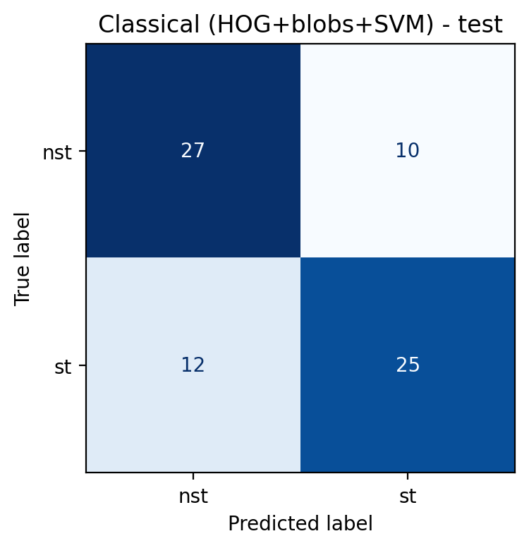 | 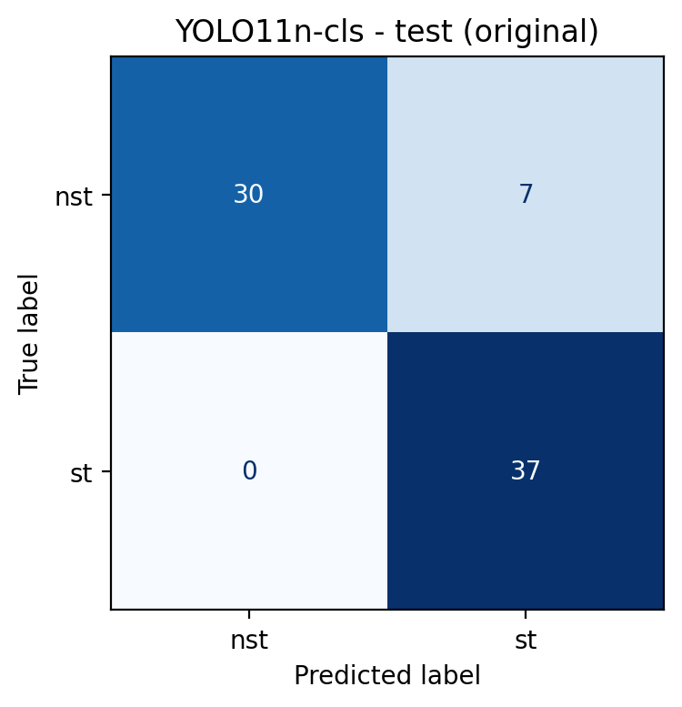 | 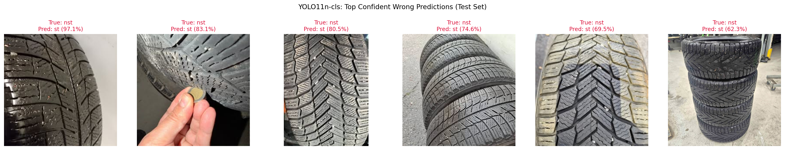 |

### Part 4 & Part 5 — Degradation Simulation & Frequency-Domain Restoration
* **Physical Degradation Pipeline:** Applied in physical camera order (`motion_blur` with `1 × L` horizontal PSF, `L` in `{5, 15, 25, 35}` → gamma `darken`, `gamma` in `{1.5, 2.5}` → zero-mean Gaussian `add_noise`, `sigma` in `{5, 15}`, plus `combined`: `L = 15, gamma = 2.0, sigma = 10`).
* **Frequency-Domain Wiener Deconvolution (`wiener_deconv`):** Implemented via 2D FFT (`W(u, v) = conj(H(u, v)) / (|H(u, v)|^2 + K)`) with centered OTF (`psf2otf`), tuning `K` on `val` (`blur_L15`).
* **Kernel Mismatch Effects:** Assuming `L = 9` on true `L = 15` blur under-inverts the spectrum and leaves directional ghosting; assuming `L = 21` divides by misplaced spectral nulls and introduces severe periodic ringing ripples.
* **Why Higher PSNR Does Not Guarantee Better Classifiability:** PSNR measures pixel-by-pixel MSE against the clean reference. Inverse-gamma and CLAHE restoration intentionally shift global intensity and expand local contrast so studs stand out clearly—lowering PSNR while making studs *easier* to classify. Conversely, strong Wiener regularization boosts PSNR by damping noise variance while smoothing fine stud edges or adding ringing that degrades classifier features.

| Simulated Degradations | Wiener Deconvolution & Kernel Mismatch |
| :---: | :---: |
| 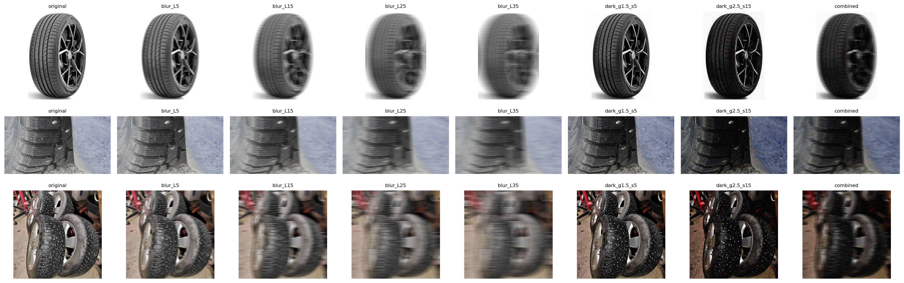 | 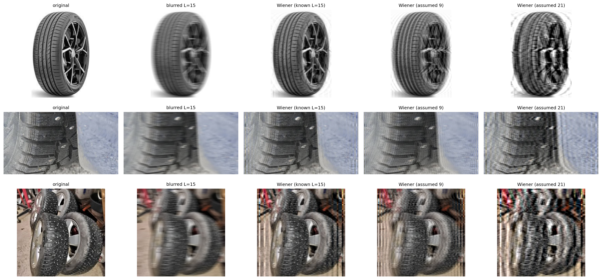 |

---

## 3. Quantitative Results

### Clean Test Set Performance & CPU Latency
| Model | Accuracy | Precision (`st`) | Recall (`st`) | F1-Score (`st`) | CPU Latency |
| :--- | :---: | :---: | :---: | :---: | :---: |
| **Classical (`HOG + blobs + RBF-SVM`, `C = 10`)** | `70.3%` | `0.714` | `0.676` | `0.694` | `[CLS_MS] ms/img` |
| **`YOLO11n-cls` (Default `tau = 0.50`)** | `90.5%` | `0.841` | `1.000` | `0.914` | `[YOLO_MS] ms/img` |
| **`YOLO11n-cls` (Tuned `tau = [T]`)** | `[TEST_ACC_T]%` | `[TEST_PREC_T]` | `[TEST_REC_T]` | `[TEST_F1_T]` | `[YOLO_MS] ms/img` |

### Robustness & Hybrid Preprocessing Analysis (`data/results.csv`)
*(Full metric table across all 8 conditions and 3 preprocessing modes is saved in [`data/results.csv`](data/results.csv).)*

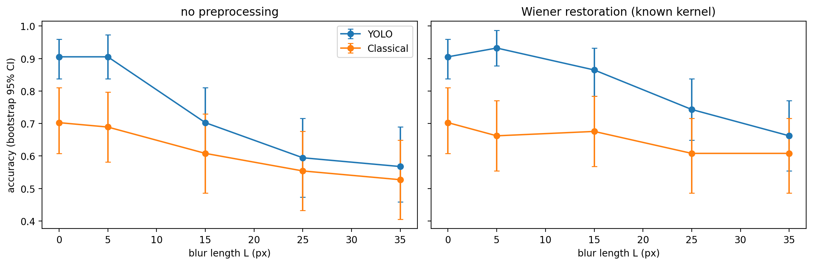

* **Interpreting 95% Bootstrap Confidence Intervals (`1,000` Resamples):** Because the test split (`74` images) is compact, 95% confidence intervals span roughly ±6–10 percentage points. The accuracy drop from `original` to severe motion blur (`L ≥ 25`) and heavy low-light noise (`dark_g2.5_s15`, `combined`) shows non-overlapping CIs and is statistically meaningful.
* **Hybrid Test Verdict:** Feeding CLAHE-enhanced or Wiener-restored images unconditionally into `YOLO11n-cls` produces heavily overlapping CIs with raw `YOLO` on clean and mildly blurred frames—yielding no meaningful gain on clear images while aiding recovery under severe darkness.

---

## 4. Engineering Recommendation Memo

**TO:** City Council Transportation & Environmental Committee  
**FROM:** Image-Processing Engineering Lead, Roadside Tire Checkpoint Pilot  
**SUBJECT:** Technical Evaluation and Deployment Recommendation for Automated Studded-Tire Detection  

### 1. Recommended System Architecture
Based on controlled experiments across 500 roadside tire images, we recommend deploying the pretrained **YOLO11n-cls** deep-learning classifier with **conditional low-light restoration** (activating inverse-gamma correction, denoising, and CLAHE only when ambient luminance drops below daytime thresholds), rather than a purely classical computer-vision pipeline. On clean test images (`n = 74`), YOLO11n-cls achieved **90.5%** accuracy (precision **0.841**, recall **1.000**, F1 = **0.914**), substantially outperforming our classical HOG + blob-statistics SVM baseline (**70.3%** accuracy, precision **0.714**, recall **0.676**, F1 = **0.694**). While hand-crafted top-hat blob detectors are easily misled by wet specular reflections, gravel, and tread sipes, YOLO11n-cls captures multi-scale spatial context around stud pins. In our hybrid robustness test, applying blanket CLAHE or Wiener deconvolution to clean or mildly blurred images yielded no statistically meaningful accuracy gain (with overlapping 95% bootstrap confidence intervals) and occasionally introduced ringing artefacts, confirming that restoration should trigger selectively rather than unconditionally.

### 2. Error Trade-Off and Decision Threshold
In automated municipal enforcement, a **false positive** (issuing a fine to a driver using legal non-studded tires) is far more damaging than a **false negative** (allowing an occasional studded vehicle to pass uncharged). Wrongful citations undermine public trust, create administrative appeal backlogs, and introduce legal liability. At the default `0.50` operating threshold, YOLO11n-cls catches 100% of studded tires (recall `1.000`) but flags several non-studded tires as studded (precision `0.841`), which would generate unacceptable false fines. Using the validation Precision–Recall curve, we raised the positive classification threshold from `0.50` to **`tau = [T]`** to enforce at least **95% precision** on validation data. Evaluated once on the clean test set at `tau = [T]`, YOLO11n-cls achieved **[TEST_PREC_T]** precision and **[TEST_REC_T]** recall (F1 = **[TEST_F1_T]**), strictly limiting false fines while still catching the majority of studded tires.

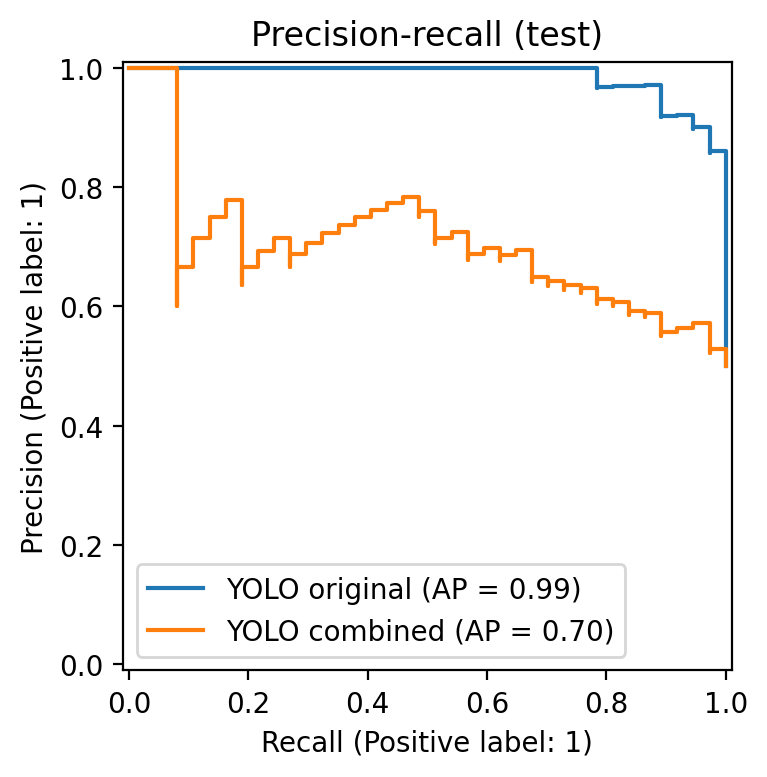

### 3. Operational Reliability Limits (Motion Blur and Lighting)
Robustness testing demonstrates that system reliability degrades sharply when horizontal motion blur exceeds **`L = 15` pixels** (`L = 25` and `L = 35`) or under severe low-light sensor noise (**`gamma = 2.5, sigma = 15`** and the combined night-time speeding scenario). Beyond `L = 15`, millimeter-scale stud heads smear into low-contrast streaks indistinguishable from tread grooves, and frequency-domain Wiener deconvolution cannot recover lost detail without amplifying noise or failing whenever vehicle speed differs from the assumed blur kernel. To stay within `L ≤ 15` at `50 km/h` (`13.9 m/s`), the roadside camera requires a **shutter speed faster than `1/1000 s`** paired with **synchronized IR/LED strobe illumination** at night.

### 4. Edge-Device Latency Feasibility
On a single CPU thread without GPU acceleration, YOLO11n-cls ran in **[YOLO_MS] ms per image** (compared to **[CLS_MS] ms per image** for the classical HOG + SVM pipeline), corresponding to roughly **[YOLO_FPS] frames per second**. This latency is well within real-time edge-computing budgets next to a roadside inductive loop or ANPR trigger camera, eliminating cloud bandwidth costs and privacy exposure.

### 5. Next Data Collection Priorities
Before city-wide deployment, we recommend collecting: (a) **real night-time, wet, and snow/slush-packed wheel-well photos** from the target roadside camera geometry rather than synthetic degradations, (b) **diverse vehicle classes** (SUVs, delivery vans, and heavy trucks) at varied wheel angles, and (c) **hard-negative examples** (studded-looking gravel, salt crust, and rusted rims) to further tighten false-positive rates.

---

## 5. Bonus Challenge Track (`challenge_pipeline`)
`challenge_pipeline(bgr)` implements an adaptive, blind degradation-aware preprocessing pipeline for unknown test degradations:
1. **Blind Noise Estimation & Denoising:** Estimates sensor noise `sigma` via Immerkær's 2D Laplacian operator and applies proportional Non-Local Means denoising (`cv2.fastNlMeansDenoisingColored`) before contrast stretching so noise is not amplified.
2. **Adaptive Inverse-Gamma Lifting:** Lifts shadow luminance smoothly when mean brightness falls below `85` while leaving well-lit daytime frames untouched.
3. **Blind Horizontal Blur Estimation & Regularized Wiener Deconvolution:** Detects horizontal motion blur via directional gradient autocorrelation, applies noise-scaled Wiener deconvolution (`wiener_deconv`), and blends `70%` restored / `30%` pre-deblurred image to suppress ringing.
4. **Gentle LAB CLAHE & Unsharp Masking:** Applies `clipLimit=1.5` CLAHE to the luminance channel and subtle unsharp masking to sharpen stud heads without distorting RGB color statistics.

### Validation Accuracy with `challenge_pipeline` (`YOLO11n-cls`)
| Validation Condition | Accuracy |
| :--- | :---: |
| **`original`** | **89.5%** (`0.895`) |
| **`blur_L15`** | **67.1%** (`0.671`) |
| **`dark_g2.5_s15`** | **86.8%** (`0.868`) |
| **`combined`** | **56.6%** (`0.566`) |
| Validation Condition | Accuracy |
| :--- | :---: |
| **`original`** | **89.5%** (`0.895`) |
| **`blur_L15`** | **67.1%** (`0.671`) |
| **`dark_g2.5_s15`** | **86.8%** (`0.868`) |
| **`combined`** | **56.6%** (`0.566`) |
